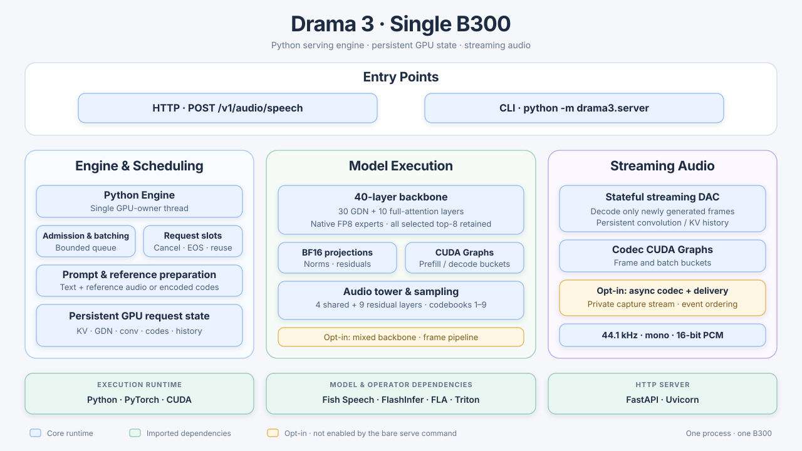

# Drama 3 · Single B300

A dedicated streaming text-to-speech engine for [Fish Audio Drama 3](https://huggingface.co/fishaudio/drama-3)
on one NVIDIA B300. Python scheduling, persistent GPU state, CUDA Graphs and
incremental DAC decoding keep the complete model-to-audio pipeline in one process.
Native FP8 experts and all selected top-8 routes are retained. Built with Fish Audio.

## Architecture



[Module details and configurations](docs/architecture.md) ·
[Implemented optimizations and experiment results](docs/optimizations.md)

## Quickstart

Requires Linux, Python 3.12, `uv`, and a B300 with a driver compatible with the
locked CUDA 13 runtime. The installer creates a venv and installs the full serving stack.

```bash
git clone https://github.com/david6666666/drama-3-single-b300-inference.git
cd drama-3-single-b300-inference

git clone https://github.com/fishaudio/fish-speech.git ../fish-speech
git -C ../fish-speech checkout 541566932abbaebcb0a40e562a1f846738383f38
python3 scripts/install_runtime.py --venv .venv --fish-source ../fish-speech

.venv/bin/hf download fishaudio/drama-3 \
  --revision e0a9218aa48888270f06ef1ed9ea67622c0e17d2 --local-dir models/drama-3

CUDA_VISIBLE_DEVICES=0 OMP_NUM_THREADS=8 .venv/bin/python -m drama3.server \
  --checkpoint models/drama-3 --fish-source ../fish-speech \
  --slots 64 --port 18082
```

`--fish-source` is the pinned **Fish Speech source checkout** used for Python classes
and codec configuration; `--checkpoint` contains the model weights and `codec.pth`.
The server becomes ready after model loading, graph capture and codec warmup.
The command uses conservative defaults; measured configurations are recorded below.

From another terminal:

```bash
curl --fail http://127.0.0.1:18082/health
curl --fail-with-body http://127.0.0.1:18082/v1/audio/speech \
  -H 'Content-Type: application/json' \
  -d '{"input":"Hello from Drama 3.","stream":true,"response_format":"pcm"}' \
  --output speech.pcm
```

Output is 44.1 kHz, mono, signed 16-bit PCM. Voice cloning accepts reference audio
plus its transcript, or pre-encoded reference codes; see [API and state flow](docs/architecture.md).

## Performance

<!-- latest-performance:start -->
Measured on **one B300**, using the same 1088 English requests and pre-encoded
references at each concurrency. Numeric rows are **medians of three complete runs**;
RTF is the median of run means. Two incomplete rows are marked below.
Versions pinned on 2026-10-16:
standalone [33f6d72](https://github.com/david6666666/drama-3-single-b300-inference/commit/33f6d7237196520be9f457d86df161264cbb087e), vLLM-Omni [aa9c9a2](https://github.com/vllm-project/vllm-omni/commit/aa9c9a2d2ce3ff8640f1b4ab8937a6194b0ead4d), SGLang-Omni [2c23b68](https://github.com/sgl-project/sglang-omni/commit/2c23b68f4f763c14cfb845eadb4883a5e791b701).

| C | Framework | Throughput (frames/s) | TTFA p50 (ms) | TTFA p95 (ms) | RTF (mean) |
|---:|---|---:|---:|---:|---:|
| 1 | drama-3-single-b300-inference | 309.17 | 32.83 | 44.68 | 0.0702 |
| 1 | vllm-omni | 195.89 | 47.29 | 49.76 | 0.1106 |
| 1 | sglang-omni | 169.80 | 79.38 | 82.82 | 0.1278 |
| 2 | drama-3-single-b300-inference | 479.42 | 47.22 | 58.04 | 0.0908 |
| 2 | vllm-omni | 346.29 | 54.25 | 60.56 | 0.1251 |
| 2 | sglang-omni | —‡ | —‡ | —‡ | —‡ |
| 4 | drama-3-single-b300-inference | 785.51 | 44.07 | 60.33 | 0.1104 |
| 4 | vllm-omni | 631.60 | 58.93 | 66.82 | 0.1371 |
| 4 | sglang-omni | 485.32 | 99.71 | 137.73 | 0.1788 |
| 8 | drama-3-single-b300-inference | 1153.25 | 53.87 | 79.31 | 0.1500 |
| 8 | vllm-omni | 1105.75 | 65.53 | 77.70 | 0.1564 |
| 8 | sglang-omni | 715.78 | 132.30 | 180.38 | 0.2421 |
| 16 | drama-3-single-b300-inference | 1857.42 | 74.94 | 100.39 | 0.1858 |
| 16 | vllm-omni | 1846.24 | 77.44 | 90.50 | 0.1861 |
| 16 | sglang-omni | 1002.32 | 184.97 | 248.58 | 0.3444 |
| 32 | drama-3-single-b300-inference | 2652.72 | 96.38 | 127.34 | 0.2551 |
| 32 | vllm-omni | 2878.10 | 95.60 | 113.42 | 0.2348 |
| 32 | sglang-omni | 1389.46 | 256.62 | 337.24 | 0.4916 |
| 64 | drama-3-single-b300-inference | 4662.02 | 147.71 | 275.61 | 0.2918 |
| 64 | vllm-omni | —† | —† | —† | —† |
| 64 | sglang-omni | 1886.22 | 384.36 | 619.29 | 0.7058 |

† vLLM C64 completed two runs (4551.91 and 4729.74 frames/s); its third run
stalled and reached the 300-second request timeout.

‡ SGLang C2 stopped after an HTTP 500 (no audio frames) in its second run;
that run had 1087 successes / 1 failure, and the third run was not attempted.
Neither incomplete row has a three-run estimate. C4–C64 used a new SGLang server
with the same configuration; see the session boundaries in the report.

`C` is the number of concurrent requests. Throughput counts returned audio frames
(2048 samples); TTFA measures time to first
PCM bytes. Complete groups include all 1088 requests and the final drain.
Standalone uses the [native B300 benchmark profile](configs/benchmark-native-b300.env).
Serving capacities are 64 / 128 / 64 and codec precision is BF16 / FP16 / FP16,
respectively.
[Configurations, quality scores, run ranges and raw evidence](docs/current-results.md).
<!-- latest-performance:end -->

## References

- [Fish Speech](https://github.com/fishaudio/fish-speech): checkpoint loader, prompt format and DAC codec.
- [FlashInfer](https://github.com/flashinfer-ai/flashinfer), [Triton](https://github.com/triton-lang/triton) and [FLA](https://github.com/fla-org/flash-linear-attention): GPU operators.
- [vLLM-Omni](https://github.com/vllm-project/vllm-omni) and [SGLang-Omni](https://github.com/sgl-project/sglang-omni): serving baselines and evaluation tools.
- [OmniRSI](https://github.com/ThinkFlowLab/OmniRSI): recorded optimization knowledge and evidence.
- [NVlabs/KDA](https://github.com/NVlabs/kda): kernel validation and profiling workflow reference.

See [NOTICE](NOTICE) and the [Fish Audio license](third_party_licenses/Fish-Audio-Community-License.txt).
