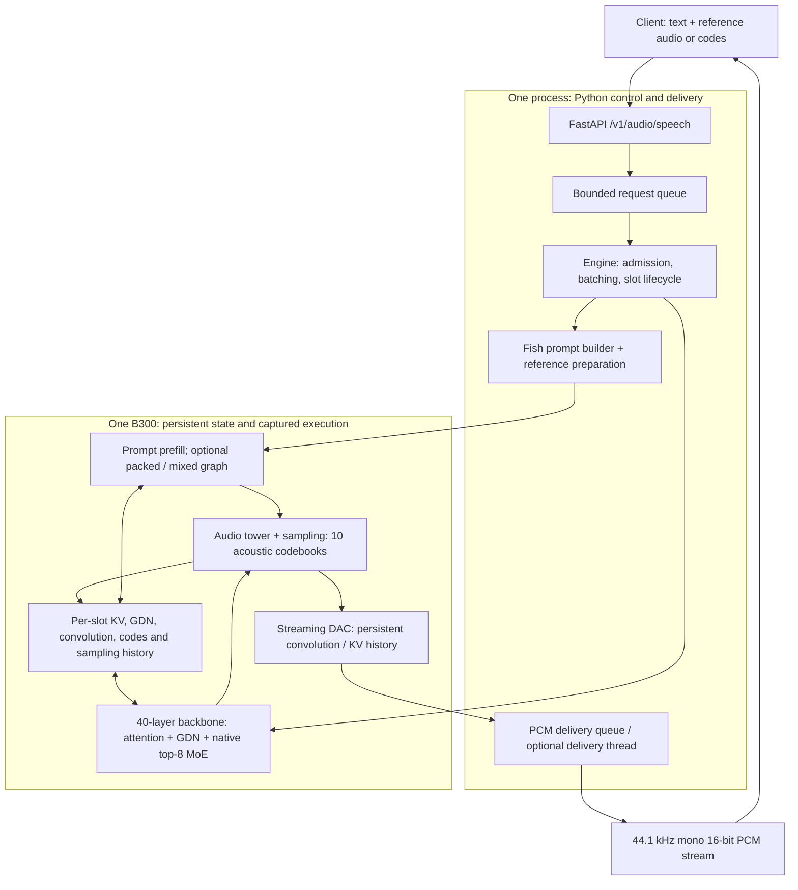

# Drama 3 on one B300

Built with Fish Audio.

A specialized, single-process streaming inference runtime for
[fishaudio/drama-3](https://huggingface.co/fishaudio/drama-3), with recorded B300
measurements for this runtime, vLLM-Omni and SGLang-Omni.

**Snapshot: 2026-10-16. Optimization is paused at the user's request.**
The target of at least **1.5× the frozen vLLM-Omni baseline at every concurrency
has not been achieved**. The highest complete-quality C64 observation is
**4726.77 frames/s**, versus the **6765.41 frames/s** target; it is one run,
not a repeated performance claim. The latest row-reuse experiment passes quality
but fails its service-throughput gate and remains disabled by default.

[Current results and provenance](docs/current-results.md) ·
[Architecture and configuration](docs/architecture.md) ·
[Reproduction](docs/reproduce-full-benchmark.md) ·
[Optimization evidence](evidence/20261016-ceiling/README.md)

## Architecture

The serving engine is implemented in **Python**, with PyTorch/CUDA Graphs,
Triton and existing GPU operators. A single GPU-owner thread admits requests,
reuses fixed request slots and schedules model work. Fish Speech supplies the
loader, prompt format and codec configuration; FlashInfer and low-level
SGLang/FLA modules supply operators. This runtime does not instantiate a vLLM,
SGLang or Fish Speech serving engine. Rust has not been implemented.



The backbone has 30 GDN and 10 full-attention layers. The audio tower has four
shared and nine residual layers. Every routed token retains all eight selected
experts and the checkpoint's native FP8 expert representation; dense execution
remains BF16. Graphs retain state between steps, and the streaming codec decodes
new frames using its own history. Optional mixed execution shares projections
and MoE work across prompt and decode rows. Optional frame pipelining overlaps
the next backbone with the current tower tail after its input dependency is ready.

See [module ownership, state lifetimes and configuration defaults](docs/architecture.md).

## Performance by concurrency

These are the **available measurements**, not a matched three-framework winner
claim. The standalone/vLLM table uses 1088 pre-encoded-reference requests per run;
SGLang's separate historical table uses 192 raw-reference-audio requests.
All rows below are medians of three runs at each concurrency. Each TTFA column
is the median of the run-level percentile; RTF is the median of run means.
Higher throughput and lower TTFA/RTF are better.

### Matched 1088-request workload: standalone and vLLM-Omni

Frozen sources: standalone `dcd20d3`, vLLM-Omni `d6ed4f4` including
[PR #8933](https://github.com/vllm-project/vllm-omni/pull/8933).
Same physical B300, corpus, encoded reference integers, sampling and client.
Serving capacities are 64 and 128 respectively; offered concurrency is identical.
Both use BF16 dense/GDN execution and native FP8 experts. This standalone profile
uses a BF16 codec; upstream uses FP16. Full controls and raw evidence are in
[the repeated comparison](docs/full-comparison.md).

| Framework | C | Throughput (frames/s) | TTFA p50 (ms) | TTFA p95 (ms) | RTF (mean) |
|---|---:|---:|---:|---:|---:|
| drama-3-single-b300-inference | 1 | 300.81 | 33.32 | 34.70 | 0.0722 |
| vllm-omni | 1 | 195.67 | 46.05 | 48.63 | 0.1107 |
| drama-3-single-b300-inference | 2 | 466.46 | 48.04 | 63.43 | 0.0932 |
| vllm-omni | 2 | 345.71 | 54.50 | 60.45 | 0.1253 |
| drama-3-single-b300-inference | 4 | 753.61 | 44.19 | 62.25 | 0.1149 |
| vllm-omni | 4 | 631.21 | 58.94 | 66.95 | 0.1373 |
| drama-3-single-b300-inference | 8 | 1091.64 | 53.36 | 77.56 | 0.1585 |
| vllm-omni | 8 | 1101.56 | 65.38 | 77.85 | 0.1571 |
| drama-3-single-b300-inference | 16 | 1591.86 | 75.76 | 103.45 | 0.2164 |
| vllm-omni | 16 | 1842.69 | 77.16 | 90.81 | 0.1863 |
| drama-3-single-b300-inference | 32 | 2167.10 | 99.29 | 146.30 | 0.3150 |
| vllm-omni | 32 | 2864.66 | 94.05 | 111.97 | 0.2354 |
| drama-3-single-b300-inference | 64 | 3451.15 | 156.33 | 414.23 | 0.3872 |
| vllm-omni | 64 | 4510.27 | 152.48 | 257.36 | 0.2859 |

This is the last complete repeated standalone matrix, **not the latest C64
configuration**. It leads vLLM at C1–C4, is close at C8 and trails at C16–C64.
Only C1 clears the throughput-only 1.5× threshold. Later C64-only observations
below do not replace its C64 row or establish newer C1–C32 results.

### SGLang-Omni: historical 192-request raw-audio workload

Frozen source `e9e016b`, capacity 64, B300 GPU0, three repetitions per concurrency,
with reference warmup. Corpus size, reference handling and client connection
policy differ from the newer coded-reference comparison. **Do not calculate
cross-table speedups or use these rows to rank all three frameworks.** A matched
1088-request, three-framework comparison has not been run. These are archived
results, not a claim about today's upstream main. [Raw records and launch](evidence/20261014-b300/sglang-cap64).

| Framework | C | Throughput (frames/s) | TTFA p50 (ms) | TTFA p95 (ms) | RTF (mean) |
|---|---:|---:|---:|---:|---:|
| sglang-omni | 1 | 168.02 | 78.98 | 82.14 | 0.1296 |
| sglang-omni | 2 | 289.90 | 88.42 | 113.64 | 0.1501 |
| sglang-omni | 4 | 478.60 | 98.54 | 140.30 | 0.1801 |
| sglang-omni | 8 | 705.36 | 136.18 | 183.08 | 0.2425 |
| sglang-omni | 16 | 953.27 | 191.04 | 251.58 | 0.3456 |
| sglang-omni | 32 | 1309.37 | 270.67 | 394.37 | 0.4880 |
| sglang-omni | 64 | 1773.49 | 439.54 | 632.33 | 0.6816 |

### Later C64 feasibility measurements

Each standalone row below has **one run and all 1088 outputs scored**. The best
observation and latest pair were measured on GPU6; the frozen repeated vLLM
baseline was measured on GPU0. They are not a new controlled cross-framework A/B.

| C64 configuration | Throughput (frames/s) | TTFA p50 (ms) | TTFA p95 (ms) | RTF (mean) | WER (%) | SIM |
|---|---:|---:|---:|---:|---:|---:|
| Best single observation, `e7cda1e` | 4726.77 | 145.65 | 273.68 | 0.2881 | 1.599 | 64.413 |
| Latest control, reuse off, `345c6a1` | 4674.81 | 148.56 | 274.70 | 0.2909 | 1.465 | 64.188 |
| Latest candidate, reuse on, `345c6a1` | 4534.13 | 151.27 | 273.35 | 0.2906 | 1.683 | 64.202 |

The latest same-source pair observes **−3.01% throughput** with row reuse enabled;
it fails the predeclared +1% continuation gate despite passing WER/SIM. Outputs
and drain duration differ, so this is not a fixed-output causal regression claim.
The 6765.41 target is still unmet. Raw timings, all quality scores and failed
experiments remain in the [evidence](evidence/20261016-ceiling/README.md).

The confirmed acceptance bounds are WER increase ≤1 percentage point and SIM
decrease ≤2 against vLLM at the same concurrency. Full acceptance requires all
1088 outputs in three repetitions at C1/2/4/8/16/32/64. The latest configuration
does not have that coverage. See [quality coverage](docs/full-quality.md),
[baseline completion](docs/scale150-progress.md#complete-baseline-quality),
[exact data and raw-metric audit](docs/current-results.json) and
[the acceptance issue](https://github.com/ThinkFlowLab/OmniRSI/issues/10).

## Implemented optimizations and their evidence

Features in the source are not all enabled by the bare serve command. The table
distinguishes the core implementation from explicit experimental profiles;
local kernel improvements are not counted as service improvements.

| Optimization | How it reduces work or overhead | Current qualification |
|---|---|---|
| Persistent slots and GPU request state | Keep KV/GDN state, generated codes, positions and repetition history on-device; manage slot reuse explicitly | Core implementation; partial-prefill primary/suffix padding isolation is fixed and checked |
| CUDA Graph batching | Capture fixed batch/shape buckets and replay decode, prefill and codec operations | Core implementation; startup includes capture and warmup |
| Packed projections and native MoE dispatch | Combine compatible QKV/GDN projections; use local small-batch kernels and FlashInfer large-batch kernels while retaining original top-8 experts | Core paths; packed router/shared projection and fused input/residual require explicit flags |
| Packed and mixed prefill | Pack prompt rows and share backbone projections/MoE with active decoding instead of always interrupting it with a separate padded pass | Opt-in; complete single-pair quality evidence, no latest all-concurrency acceptance |
| Compact GDN and padding work | Compact active state handling and avoid unnecessary work on reserved padding slots | Opt-in in the later C64 profile; full state/ownership gates retained |
| Streaming DAC and codec overlap | Preserve convolution/attention history and decode only new audio frames; optionally overlap codec and model work with private capture workspaces and queued PCM delivery | Streaming codec is core; asynchronous execution is opt-in; shared-workspace failure remains documented |
| Two-frame pipeline and deferred admission | Start the next backbone once semantic/codebook-1 dependencies are ready; permit pairing while arrivals are below admission thresholds | Opt-in; complete quality in single C64 trials; no all-concurrency speedup claim |
| Exact causal-prefix MoE row reuse | Compute identical prompt-prefix rows once and gather their results through an inverse map | **Experimental, default off:** 9974 correctness checks pass; local graph latency improves 6.23–6.77%, but the complete service pair is slower |

Resident expert fusion, M128/scale-cache variants, transparent compressed
allocation and codec cached-linear variants did not clear their declared
performance gates. Dense FP8 serving is rejected. Those experiments are retained
for auditability and are not recommended serving optimizations. The CPU SIMT
proposal was stopped before GPU execution; it is not a measured speedup.

High-concurrency profiling shows that a faster isolated decode graph does not
ensure higher service throughput: prompt work, codec contention, graph padding,
admission and final drain also count. Sampled native MoE kernels move substantial
expert-weight data while showing low tensor-pipe activity. Higher CTA residency
alone did not improve issue progress enough. Neither an isolated 7734 frames/s
calculation nor a bandwidth estimate establishes an end-to-end upper bound.
See [scaling analysis](docs/performance-gap.md) and
[the complete experiment ledger](docs/scale150-progress.md).

## Scope

- One B300, native FP8 expert weights and BF16 dense execution. GDN state defaults
  to FP32; the measured profiles above explicitly select BF16.
- Streaming mono PCM at 44.1 kHz; one inline or pre-encoded voice reference.
- Temperature 1, top-p 0.9, top-k 30, up to 500 acoustic frames.
- Continuous batching at capacities 1–64; one model and one codec per process.
- No training or multi-GPU execution. Default execution preserves checkpoint precision.
- Dense FP8 was rejected after numerical and latency diagnostics; its prototype
  remains only in diagnostic scripts and is not a serving option.

The benchmark contract and provenance are in [docs/draft.md](docs/draft.md).
The complete 1088-request comparison commands and exact experimental flags are
in [the reproduction guide](docs/reproduce-full-benchmark.md).
Exact source revisions, model/dataset revisions and dependency snapshots are
under [evidence/20261014-b300](evidence/20261014-b300).

## Benchmark tools

Install the lightweight client and CPU tests:

```bash
uv venv --python 3.12 /path/to/benchmark-venv
uv pip install --python /path/to/benchmark-venv/bin/python -e '.[dev]'
/path/to/benchmark-venv/bin/pytest -q
```

Prepare the pinned Seed-TTS English subset with `scripts/prepare_corpus.py`.
Use `scripts/run_baseline.py --help` to launch a baseline from an explicitly
supplied source checkout and environment. The launcher records the source SHA,
command and readiness time, runs the client, and shuts down only its own process
group. Benchmark requests use the same waveform and transcript for both APIs.

```bash
drama3-bench --url http://127.0.0.1:18080 --backend sglang \
  --corpus /path/to/requests.jsonl --output /path/to/new-results \
  --concurrency 1 2 4 8 16 32 64 --requests 192 --repeats 3 \
  --warm-references --save-audio
```

Throughput counts returned audio samples / 2048 per measured batch second.
TTFA starts at dispatch and ends at the first PCM bytes. Mean RTF divides each
request's dispatch-to-last-audio time by its output audio duration. Failed
requests invalidate a run; they are preserved in raw timing records.

## Candidate runtime

The development environment uses the pinned SGLang CUDA dependencies recorded
in the evidence directory, plus the pinned Fish Speech checkout installed with
`--no-deps` to retain the tested Torch/CUDA stack. The command below uses the conservative defaults; it does not reproduce the
experimental C64 profile. See [the exact recorded profile](docs/architecture.md#recorded-c64-profile).

```bash
CUDA_VISIBLE_DEVICES=0 OMP_NUM_THREADS=8 python -m drama3.server \
  --checkpoint /path/to/pinned-drama-3-snapshot \
  --fish-source /path/to/pinned-fish-speech --slots 64 --port 18082
```

`--fish-source` is the root of a local **Fish Speech source checkout**, such as
`/opt/fish-speech`; `/path/to/pinned-fish-speech` is a placeholder. It must contain
`fish_speech/configs/modded_dac_vq.yaml`, which the server reads to construct the
audio codec. `--checkpoint` separately points to the Drama 3 model snapshot,
including model weights and `codec.pth`.

“Pinned” means checked out at the tested commit
`541566932abbaebcb0a40e562a1f846738383f38`. Fish Speech also supplies the imported
model loader, prompt builder and codec classes. Install that same checkout into
the serving environment with the installer below: the server argument itself
does not install Python packages or change their import path. No Fish Speech
server is launched; admission, batching, model execution and streaming are
managed by this repository.

`/health` becomes ready only after checkpoint loading, CUDA Graph capture and
codec warmup. Use `--backend standalone` with the same benchmark command.
The runtime keeps generated codes and repetition history on the GPU, and
its streaming codec retains convolution and attention history between chunks.

Install the complete measured runtime stack with:

```bash
git clone https://github.com/fishaudio/fish-speech.git /path/to/pinned-fish-speech
git -C /path/to/pinned-fish-speech checkout 541566932abbaebcb0a40e562a1f846738383f38
python scripts/install_runtime.py --venv /path/to/runtime-venv \
  --fish-source /path/to/pinned-fish-speech
```

For comparisons with PR #8933, use `scripts/encode_references.py` to prepare
one shared corpus of reference codes. Both APIs then receive identical
`ref_audio_codes` integers and `ref_text`. Preparation is timed separately.
Inline reference audio is still supported, but vLLM-Omni encodes that audio
per request; its results are a separate workload and cannot be substituted
for the production-serving baseline. Every measured request opens a fresh
TCP connection on both backends, without automatic retries.

`scripts/validate_model.py` compares operators and layers with Fish Speech's
reference math. `scripts/evaluate_audio.py` scores saved audio with the upstream
Seed-TTS WER calculation, Whisper-large-v3 and WavLM speaker similarity. Missing
quality coverage cannot produce a passing result.

## References

- [OmniRSI PR #9](https://github.com/ThinkFlowLab/OmniRSI/pull/9): Strata,
  vLLM-Omni and SGLang-Omni serving knowledge packs.
- [vLLM-Omni](https://github.com/vllm-project/vllm-omni) and
  [SGLang-Omni](https://github.com/sgl-project/sglang-omni): main-branch baselines.
- [Fish Speech](https://github.com/fishaudio/fish-speech): reference architecture.
- [NVlabs/KDA](https://github.com/NVlabs/kda): numerical validation and kernel
  profiling workflow. Kernels here are not claimed to be KDA-generated.

See [NOTICE](NOTICE) and [Fish Audio's license](third_party_licenses/Fish-Audio-Community-License.txt)
for the Fish Audio materials and dependency attribution.
