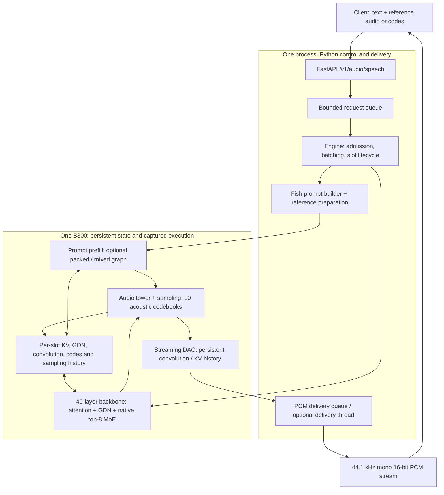

# Runtime architecture

This describes the implemented Python runtime at the 2026-10-16 snapshot.
There is no Rust engine in this repository. Source features, defaults and
measured profiles are distinct; the latest all-concurrency target has not passed.



## Module ownership

| Module | Responsibility |
|---|---|
| [server.py](../src/drama3/server.py) | FastAPI validation, streaming `/v1/audio/speech`, readiness and request cancellation; listens on loopback |
| [engine.py](../src/drama3/engine.py) | Single GPU-owner thread, pending/admission queues, slot allocation, batch selection, capture, model/codec scheduling and final drain |
| [runtime_state.py](../src/drama3/runtime_state.py) | Persistent device frames, history, positions and generated-code storage |
| [model.py](../src/drama3/model.py) | Fish weight loader, 40-layer backbone, tower, attention and native top-8 expert dispatch |
| [kernels.py](../src/drama3/kernels.py) and [ops](../src/drama3/ops) | Triton/direct operators, GPU sampling, native FP8 MoE and DAC operations |
| [packed_prefill.py](../src/drama3/packed_prefill.py) | Optional variable-length packed prompt execution |
| [mixed_graph.py](../src/drama3/mixed_graph.py) / [mixed_model.py](../src/drama3/mixed_model.py) | Optional graph combining active decode rows with prompt rows through shared projections/MoE |
| [frame_pipeline.py](../src/drama3/frame_pipeline.py) | Optional two-frame schedule: next backbone starts after the codebook-1 dependency, overlapping the current tower tail |
| [row_reuse.py](../src/drama3/row_reuse.py) | Optional exact same-admission prefix mapping and finite compact buckets; disabled by default after failed service screen |
| [codec.py](../src/drama3/codec.py) / [audio_queue.py](../src/drama3/audio_queue.py) | Native DAC loading, streaming graph state, optional asynchronous codec queue and host PCM delivery |
| [benchmark.py](../src/drama3/benchmark.py) and [scripts](../scripts) | Streaming metrics, launch/source provenance, profiling, correctness and full audio-quality evaluation |

## Request and state lifecycle

1. The API validates text and at most one reference: inline audio plus transcript,
   or ten rows of pre-encoded reference codes plus transcript. Inline audio can
   require encoding; pre-encoded references avoid that per-request work.
2. The engine builds the Fish prompt, admits a request into a free slot and
   initializes that slot's model and codec state. Prefill executes the prompt;
   packed/mixed paths are enabled only by explicit configuration.
3. The backbone consumes semantic/codebook inputs. Its 30 GDN and 10 full-attention
   layers update persistent recurrent/KV state. The audio tower's four shared and
   nine residual layers generate ten codebooks, with GPU sampling/history updates.
4. Decode graphs replay in capacity buckets while admission, EOS, cancellation,
   audio chunk boundaries and maximum length constrain multi-step scheduling.
   Live requests and padding rows have distinct primary/suffix state ownership.
5. The channels-last DAC decodes new frames using persistent convolution and
   attention history. A frame represents 2048 samples. The API streams mono
   44100 Hz, 16-bit PCM and drains pending audio before marking the audio response complete.
   Model-slot release and later host PCM delivery are distinct lifecycle events.

The optional asynchronous codec uses a dedicated capture stream to isolate
BLAS workspaces from the model. Events and queued delivery order the generated
codes, codec output and CPU transfer; allocating separate Python objects alone
does not establish safe GPU workspace ownership. Earlier shared-workspace
corruption is retained in the experiment record.

Graph memory-pool reuse also requires explicit output lifetime management:
`MixedGraph.run()` clones outputs that must survive another replay. GDN state,
KV data, request history, padding slots and retained outputs are all covered by
the expanded correctness checks. Exact graph parity does not replace WER/SIM.

Readiness follows checkpoint loading, enabled CUDA Graph capture and codec
warmup. Startup and reference preparation are recorded separately from measured
request throughput; the endpoint does not claim readiness after import alone.

## Defaults versus experimental profiles

The bare serve command is conservative and **does not reproduce the later C64
measurements**. Do not inherit arbitrary `DRAMA3_*` variables when reproducing a run.

| Setting | Bare default | Later recorded C64 profile |
|---|---|---|
| Dense weights / execution | BF16 | BF16 |
| Routed experts | Native FP8, original scales, all top-8 | Same |
| GDN state | FP32 | Explicit BF16 |
| Prefill MoE / GDN / convolution | `native` / `fla` / `torch` | `flashinfer` / `fla` / `triton` |
| Codec | BF16 streaming DAC | BF16 streaming DAC |
| Packed/mixed prefill | Off | On; bounded span and fallback |
| Fused MoE input/residual and compact GDN | Off | On |
| Asynchronous codec / PCM thread | Off | On with dedicated capture stream |
| Frame pipeline / deferred waiting | Off | On |
| Prefix row reuse | Off | Off; the later on/off pair failed its throughput gate |
| Codec cached linear / coalescing / SM restriction | Off / off / no restriction | Off / off / no restriction |

The state dtype is part of each frozen run's provenance, not a silent precision
change. Native expert weights, scales and selected expert count are preserved;
no dynamic expert reduction or new lossy expert re-encoding is selected.

## Recorded C64 profile

The highest complete-quality single observation (4726.77 frames/s) used source
`e7cda1eba083603b88e1f2e89688e1ff2ced7fc2` and this exact `DRAMA3_*` environment:

```bash
export DRAMA3_GDN_STATE_DTYPE=bfloat16
export DRAMA3_PREFILL_GDN=fla
export DRAMA3_PACKED_MOE_PROJECTION=1
export DRAMA3_PREFILL_CONV=triton
export DRAMA3_PREFILL_MOE_TUNED=0
export DRAMA3_PREFILL_MOE=flashinfer
export DRAMA3_ADMISSION_MIN_BATCH=6
export DRAMA3_PREFILL_BUCKET_192=1
export DRAMA3_PACKED_PREFILL=1
export DRAMA3_ASYNC_CODEC=1
export DRAMA3_AUDIO_DELIVERY_THREAD=1
export DRAMA3_FUSED_MOE_INPUT=1
export DRAMA3_MIXED_BACKBONE=1
export DRAMA3_MIXED_SPAN256=1
export DRAMA3_CODEC_DEDICATED_CAPTURE_STREAM=1
export DRAMA3_COMPACT_GDN=1
export DRAMA3_FUSED_MIXED_LAYOUT=1
export DRAMA3_PACKED_CONV_GUARD=1
export DRAMA3_DEFER_CODEC_SUBMIT=0
export DRAMA3_CODEC_SPLIT_POLICY=dp
export DRAMA3_SHORT_PADDING_CONTEXT=1
export DRAMA3_FUSED_MOE_RESIDUAL=1
export DRAMA3_CODEC_SMS=0
export DRAMA3_RESERVED_PADDING_ROUTER=1
export DRAMA3_FRAME_PIPELINE=1
export DRAMA3_FRAME_PIPELINE_DEFERRED_WAITING=1
export DRAMA3_CODEC_CACHED_LINEAR=0
export DRAMA3_CODEC_COALESCE=0
```

Use a clean checkout at that revision and the pinned runtime environment when
reproducing it. These flags are documented for provenance, not a new performance
promise. The [launch record](../evidence/20261016-ceiling/results/codec-cache-control-gpu6/launch.json)
contains GPU selection, CPU affinity, command, readiness and client hash.
The [summary](../evidence/20261016-ceiling/results/codec-cache-service-summary.json)
includes all 1088 quality scores' aggregates. It is not three repetitions.
The later `345c6a1` row-reuse pair is recorded
[separately](../evidence/20261016-ceiling/results/native-row-reuse-service/summary.json).

## External code and weights

`--checkpoint` points to the pinned Drama 3 Hugging Face snapshot and includes
model weights and `codec.pth`. `--fish-source` points to the local **source checkout**
of Fish Speech, pinned to `541566932abbaebcb0a40e562a1f846738383f38`.
The latter must contain `fish_speech/configs/modded_dac_vq.yaml`; the same checkout
must also be installed in the serving venv because the loader, prompt builder and
codec classes are Python imports. The flag does not install packages or change
Python's import path. The [installer](../scripts/install_runtime.py) checks the
pinned source and installs the measured dependencies.

FlashInfer and low-level SGLang/FLA operators are reused directly. Their serving
engines and schedulers are not running inside this engine. KDA influenced the
correctness/profiling workflow; the repository does not claim KDA-generated kernels.
