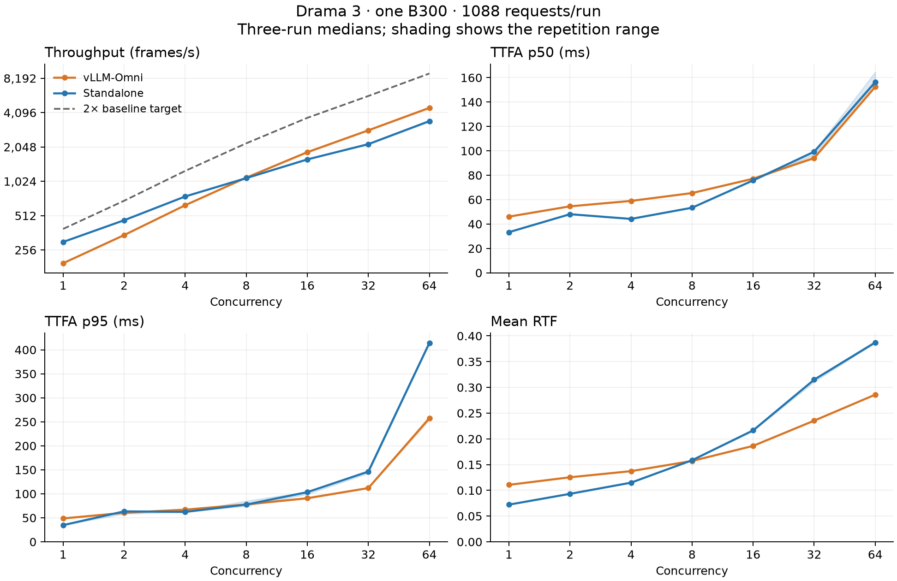

# Measured streaming performance

**The current 1.5× target is not achieved.** The standalone runtime leads at C1–C4,
is close at C8, and trails the updated vLLM baseline at C16–C64.

Both runtimes completed 21 valid runs: 1088 requests × seven concurrency points
× three repetitions, or 22,848 successful measured requests per runtime.
All 45,696 raw request records were audited for matching sample identity,
frame counts, RTF and recomputed summary metrics. No failed requests were removed.

The comparison uses the same physical B300 (GPU 0), CPU affinity, eight OpenMP
threads, checkpoint, 1088-row corpus, pre-encoded reference integers and client
implementation. Sampling is temperature 1 / top-p 0.9 / top-k 30, max 500 frames.
Per-concurrency warmup is `max(8, C)`; corpus-wide reference warmup is skipped
for both. Each request uses a fresh TCP connection without retries. Source
checkouts were clean and frozen at vLLM-Omni `d6ed4f4` and standalone `dcd20d3`.

The upstream capacity is 128 and standalone capacity is 64; offered concurrency
is the same. Both use native FP8 experts, BF16 dense weights and BF16 GDN state.
The upstream codec uses FP16; this formal standalone candidate uses its BF16
codec. A subsequent FP16 codec experiment is recorded separately in
[the feasibility report](full-corpus-results.md), not substituted into these results.

Median of three complete runs. TTFA is in milliseconds; throughput is acoustic frames/s.

| Runtime | C | Frames/s | TTFA p50 | TTFA p95 | Mean RTF | Ratio to new vLLM |
|---|---:|---:|---:|---:|---:|---:|
| vllm | 1 | 195.67 | 46.05 | 48.63 | 0.1107 | — |
| candidate | 1 | 300.81 | 33.32 | 34.70 | 0.0722 | 1.537× |
| vllm | 2 | 345.71 | 54.50 | 60.45 | 0.1253 | — |
| candidate | 2 | 466.46 | 48.04 | 63.43 | 0.0932 | 1.349× |
| vllm | 4 | 631.21 | 58.94 | 66.95 | 0.1373 | — |
| candidate | 4 | 753.61 | 44.19 | 62.25 | 0.1149 | 1.194× |
| vllm | 8 | 1101.56 | 65.38 | 77.85 | 0.1571 | — |
| candidate | 8 | 1091.64 | 53.36 | 77.56 | 0.1585 | 0.991× |
| vllm | 16 | 1842.69 | 77.16 | 90.81 | 0.1863 | — |
| candidate | 16 | 1591.86 | 75.76 | 103.45 | 0.2164 | 0.864× |
| vllm | 32 | 2864.66 | 94.05 | 111.97 | 0.2354 | — |
| candidate | 32 | 2167.10 | 99.29 | 146.30 | 0.3150 | 0.756× |
| vllm | 64 | 4510.27 | 152.48 | 257.36 | 0.2859 | — |
| candidate | 64 | 3451.15 | 156.33 | 414.23 | 0.3872 | 0.765× |

This table alone does not establish acceptance. Complete quality coverage, matched
workloads and the recorded experiment controls must also pass. Missing evidence is
INCONCLUSIVE, never PASS.

Throughput-only 1.5× gate across all concurrency levels: **FAIL**. Quality is a separate required gate.

The figure shows three-run medians and minimum-to-maximum shading; it is not a
confidence interval. Throughput uses a logarithmic vertical axis. Download the
[PDF figure](figures/full-comparison.pdf) or [exact plot data](figures/full-comparison.json).

Full-corpus reference preparation encoded 666 unique references in 25.29 s.
Process-to-readiness was 360.05 s for vLLM and 42.03 s for standalone, with
existing JIT/model caches; those are single startup observations, not cold-start
benchmark claims. Preparation and startup are outside the measured batches.

Raw PCM does not expose finish reasons. Outputs reaching the 500-frame cap
remain in both performance and quality results; no claim of complete EOS
coverage is made. See the [raw audit](../evidence/20261015-b300/full-comparison-raw-audit.json),
[baseline records](../evidence/20261015-b300/vllm-8933-codes1088),
[standalone records](../evidence/20261015-b300/candidate-prefill192-codes1088-formal),
[audio quality](full-quality.md), and [reproduction commands](reproduce-full-benchmark.md).
